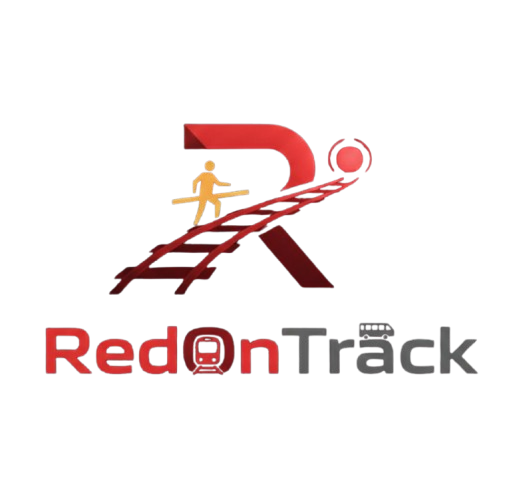
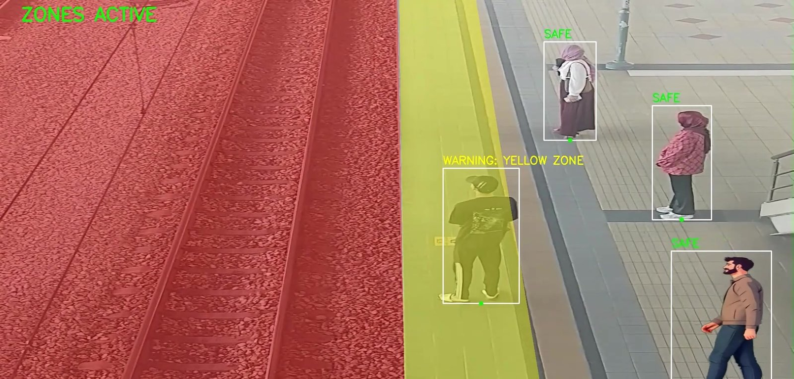
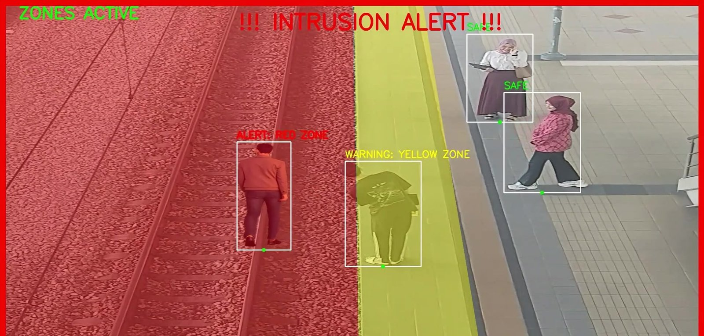

<div align="center">
  
  <h1>RedOnTrack</h1>
  <p>CCTV monitoring and incident analysis dashboard for railway stations.</p>
</div>

RedOnTrack gives station staff one place to watch platform cameras, log incidents, review footage from several angles, and get a structured safety analysis of each incident (cause, risk level, preventive actions, summary for the station log).

> **Prototype status:** camera feeds are simulated and the dataset is sample data. Login and roles work, but run in the browser only (see [Limitations](#limitations)).

## Edge AI model

RedOnTrack's Edge AI model runs on existing station CCTV. It detects people and checks each one against two zones: the **red zone** (the track) raises an intrusion alert, the **yellow zone** (the warning strip) raises a warning, and everyone else is marked safe.

| Safe and yellow-zone warning | Red-zone intrusion alert |
| --- | --- |
|  |  |

**Model:** YOLO11n (Ultralytics) fine-tuned for 50 epochs at 640 px on two classes, `person` and `train`. Weights: [`model/best.pt`](model/best.pt). While a train is detected at the platform the zones are switched off ("TRAIN PRESENT: ZONES DISABLED"), so passengers boarding don't trigger alarms.

All four dashboard cameras play recorded runs of the model (`public/footage/`):

| Camera | Scenario | Model alerts |
| --- | --- | --- |
| Platform 1 | Train arriving | none (zones switch off when the train arrives) |
| Platform 2 | No train, person walks onto the track | INTRUSION ALERT at 2.4–3.4 s, 5.0–8.0 s, 8.5–12.0 s |
| Platform 3 | Train at platform | none (zones disabled) |
| Platform 4 | Train departing | none until the zones switch back on |

The dashboard follows the model's own alert timing: the alerting feed turns red and each alert is logged under **Live alerts**. Red-zone incidents replay the Platform 2 footage.

Run the model on your own video:

```bash
pip install ultralytics
yolo detect predict model=model/best.pt source=your_video.mp4
```

Run it with the red/yellow zone rules (the same rules as the dashboard's **Live Detection** page), using a zone file exported from the Cameras page:

```bash
pip install ultralytics
python model/zone_detect.py --source your_video.mp4 --zones zones_CAM-02.json --out annotated.mp4
python model/zone_detect.py --source 0 --zones zones_CAM-02.json --show   # webcam
```

It prints each alert and writes them to `events.csv`. The browser copy of the model is `public/model/redontrack.onnx`, exported with `yolo export model=model/best.pt format=onnx imgsz=640 opset=17 simplify=True`.

[Add a link to the training notebook or dataset.]

The model is built on Ultralytics YOLO11, licensed AGPL-3.0.

## Live Detection (new)

The **Live AI** page runs the RedOnTrack model **inside the browser** (ONNX Runtime Web, WebAssembly). Frames never leave the device, like an edge box at the station would work.

- **Any source:** the sample clips, an uploaded video, or a webcam / USB camera.
- **Uses your zones:** the red and yellow zones drawn on the Cameras page are applied live. A person is placed by their feet (bottom-centre of the box).
- **Risk levels by time in zone:** red zone = MEDIUM at once, HIGH once confirmed (0.5 s by default, filters one-frame glitches). Yellow strip = LOW, MEDIUM after lingering (3 s). Thresholds are adjustable with sliders.
- **Person tracking:** each person keeps an ID between frames, so the dashboard knows how long *that* person has been in the zone.
- **Train gate:** zones switch off only when a train is confident (score ≥ 0.8), covers the track zone (≥ 25 %), and stays for 1 s. This stops false "train" boxes on the platform strip from silencing alerts.
- **Auto-logged incidents:** confirmed events are added to the Incident log (operators and admins), with a snapshot card and CSV export of all events.

The same rules run on the edge in `model/zone_detect.py`, so the dashboard and the device agree. Logic and tests: `src/services/detectionService.ts`, `src/__tests__/detection.test.ts`.

## Features

| Area | What it does |
| --- | --- |
| **Login & roles** | Employee-ID sign-in with hashed passwords, lockout after 5 failed attempts, and three roles: Administrator, Operator, Viewer. Pages and actions are hidden or blocked by role. |
| **Camera monitoring** | Live grid of 4 platform cameras. Full-screen view with next/previous, **snapshot (PNG)** and **clip recording (WebM)**. Reorder the grid. Platform 2 acts out a passenger stepping past the yellow line about every 30 s, which raises an on-screen alert and logs it under **Live alerts**. |
| **Device configuration** | Admins and operators can rename a camera and set its **red and yellow detection zones** by dragging the zone corners on the camera image (or with arrow buttons and keys). Zones are saved per camera and can be exported as `zones_CAM-xx.json` (normalised 0–1 coordinates) for the model's zone script. |
| **Incident replays** | **View cameras** on an incident replays that event from every camera that recorded it (slip, trespass, crowding, unattended bag, platform edge, door fault), with the subject boxed and labelled. |
| **Incident analysis** | Weekly/monthly charts by day or 4-hour time slot. Click a bar to filter the incident list. |
| **Incident log** | Edit investigation remarks, save incidents to the archive, open every camera angle for the incident, export a text report. |
| **AI analysis** | One click produces anomaly detection, a risk score, 3–5 preventive measures and a summary. Uses Gemini when configured, otherwise a built-in rule-based analyser that works offline. |
| **Live detection** | Runs the model in the browser on a clip, uploaded video or webcam with the camera's zones, dwell-time risk levels, a train gate and auto-logged incidents. See [Live Detection](#live-detection-new). |
| **Footage catalog** | 7-day index of continuous recordings per camera, with playback. |
| **Access log** | Admin-only record of every sign-in and sign-out, searchable and exportable to CSV. |

## Demo accounts

| Role | Employee ID | Password | Can do |
| --- | --- | --- | --- |
| Administrator | `10064620` | `admin123` | Everything, including the access log |
| Operator | `22839401` | `operator123` | Edit, save, analyse, export, capture footage |
| Viewer | `33910284` | `viewer123` | Read only |

New sign-ups start as Viewers.

## Quick start

Requires Node.js 18+.

```bash
npm install
npm run dev        # http://localhost:3000
```

Other scripts:

```bash
npm test           # unit tests (Vitest)
npm run typecheck  # TypeScript, strict mode
npm run build      # production build in dist/
```

## AI analysis setup (optional)

Without any configuration the app uses the offline rule-based analyser. To use Gemini, copy `.env.example` to `.env` and pick **one** option:

| Option | Variable | Use for |
| --- | --- | --- |
| Server proxy (recommended) | `VITE_AI_PROXY_URL=/api/analyze` plus `GEMINI_API_KEY` on the server | Any public deployment. The key never reaches the browser. |
| Direct | `VITE_GEMINI_API_KEY=...` | Local development only. The key is bundled into the JavaScript. |

If Gemini fails (quota, network), the app shows the offline analysis and says why.

## Using your own footage

Each camera in `src/constants/index.ts` takes an optional `videoUrl`. Point it at a clip you recorded (for example `./footage/platform1.mp4` in `public/`) and that camera plays the clip instead of the simulated feed. Snapshot and recording work on real clips too.

## Tech stack

React 19 · TypeScript (strict) · Vite 6 · Tailwind CSS 3 · React Router 7 · Vitest · Gemini REST API · ONNX Runtime Web · Ultralytics YOLO11 (Python edge script)

## Project structure

```text
src/
├── components/   UI pieces: Header, CCTVFeed, SimulatedFeed, IncidentCard, modals
├── pages/        One file per screen
├── hooks/        useAuth (context + route guard), useIncidents, useAccidentAnalytics
├── services/     Logic with no React: auth, incidents, analytics, AI, export, storage, feed renderer
├── domain/       Shared TypeScript types
├── constants/    Camera list and branding
└── __tests__/    Unit tests for the services
api/analyze.ts    Serverless Gemini proxy (Vercel)
```

More detail: [Architecture](docs/ARCHITECTURE.md) · [User guide](docs/USER_GUIDE.md) · [Deployment](docs/DEPLOYMENT.md)

## Limitations

- **Auth is client-side.** Accounts, sessions and the access log live in the browser's localStorage. It demonstrates role-based access but is not a security boundary. Replace `src/services/authService.ts` with Firebase Auth, Supabase Auth or similar before real use.
- **Data is local and sample-based.** Incidents and chart figures are sample data stored per browser.
- **Analysis reads text, not video.** Both engines analyse the incident metadata and staff remarks. Sending video frames to a vision model is the next step.
- **Camera grid alerts follow recorded timings.** The Cameras page plays recorded model runs and uses their alert windows. Real detection runs on the **Live AI** page and in `model/zone_detect.py`.
- **Browser inference is CPU-only.** Expect a few frames per second on a laptop; the edge script or a GPU is faster. The sample clips have the old overlay burned in, so raw footage gives cleaner detections.
